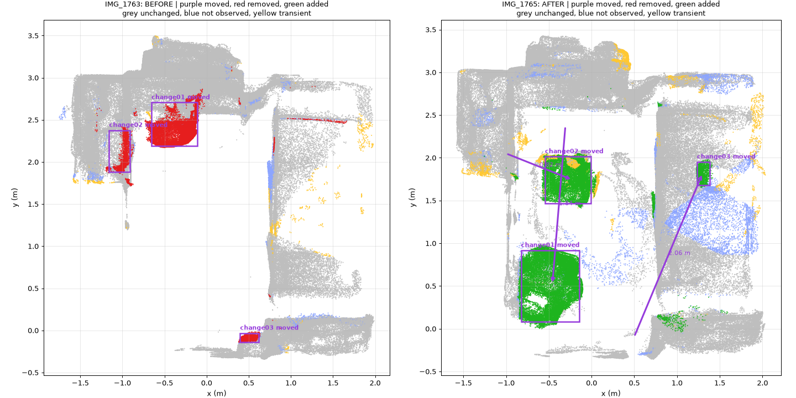
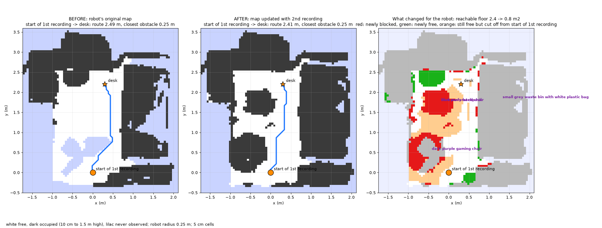

# RoomDelta

**What changed in the room?** A tool that compares two phone videos of the same indoor space and tells you what changed, in 3D.

Record a space, move things around, record it again, and run one command. You get:

* a **shared 3D model** of both recordings
* every object that was **moved, added or removed**, with its position and size in metres
* a **plain English description** of each change (optional, uses Claude)
* what the changes mean **for a robot**: newly blocked floor, floor that is now cut off, and a replanned route

Changes are only reported where both recordings actually looked. Anything one recording never saw is marked unknown instead of changed, so a different camera path, occlusion or a missed corner does not produce false alarms.

```bash
uv run python run.py before.mov after.mov
```

## Setup

Tested on macOS (Apple Silicon) with Python 3.11. Linux should work the same way without the Homebrew step, but is untested.

```bash
git clone https://github.com/kirill271204/RoomDelta.git
cd RoomDelta
brew install uv libusb          # macOS: uv manages Python, Open3D needs libusb
uv sync                         # creates .venv with all Python packages
git clone https://github.com/facebookresearch/vggt.git third_party/vggt
```

On the first run VGGT downloads its weights (about 5 GB) and DINOv2 about 90 MB.

For the descriptions, add an Anthropic API key (optional; without it everything else still runs):

```bash
cp .env.example .env            # then put your key in .env
```

## Record your space

1. Film the space once: walk slowly, keep the phone at a steady height, and cover it from at least two directions. 20 to 60 seconds is plenty.
2. Move, add or remove some objects.
3. Film it again. Take a different path if you like: overlap between the recordings is what matters, not identical viewpoints.

Works best for a room sized space with some texture (furniture, objects on surfaces). Plain white walls alone give VGGT little to work with.

## Run

```bash
uv run python run.py BEFORE_VIDEO AFTER_VIDEO
```

| Option | Default | What it does |
| :--- | :--- | :--- |
| `--frames-per-video N` | 30 | Frames per video given to VGGT. More frames give better coverage and need more memory |
| `--camera-height M` | 1.4 | Roughly how high the phone was held, in metres. Sets the real world scale |
| `--reconstruction FILE` | | Use a VGGT result computed elsewhere (see Hardware) instead of running VGGT here |
| `--goal X Y` | | Robot goal on the map, in metres. Without it the map still shows reachable floor |
| `--goal-name NAME` | goal | Label for the goal in the plots |
| `--robot-radius M` | 0.25 | Robot radius in metres; obstacles are padded by this |
| `--no-describe` | | Skip the Claude descriptions |
| `--out DIR` | `outputs/BEFORE_vs_AFTER` | Output folder |

A good way to choose `--goal`: run once without it, read the coordinates off `navmap.png`, then run again. Frames and the VGGT reconstruction are cached in the output folder, so the second run only redoes the fast steps (about a minute).

## Outputs

| File | Contents |
| :--- | :--- |
| `changes_described.json` | The change list with labels, descriptions and a summary for the robot |
| `changes.json` | The change list from geometry alone: type, position, size, distance moved, match scores |
| `changes_topdown.png` | Top view of both recordings: removed (red), added (green), moved (purple arrows) |
| `navmap.png` | Robot map before and after, route, newly blocked and cut off floor |
| `navigation.json` | Route lengths, clearances and floor areas |
| `changes.rrd`, `scene.rrd` | Interactive 3D views: `uv run rerun OUTPUT_DIR/changes.rrd` |
| `objects/` | Crops of every changed object, before and after, plus a context frame |
| `run_settings.json` | The settings used, for reproducing the run |

Coordinates are in metres, with the floor at z = 0, z pointing up, and the start of the first recording near the origin.

## How it works

1. **Frames.** From each video, the sharpest frame in each of N equal time windows (motion blur is skipped, coverage is kept).
2. **One shared 3D model.** All frames of *both* videos go through [VGGT](https://github.com/facebookresearch/vggt) in a single pass. Everything that did not change anchors both recordings in the same coordinate frame, so no separate alignment step is needed.
3. **Level and scale.** The floor is found with RANSAC and becomes z = 0. VGGT has no real world scale, so the scene is scaled from the assumed phone height (about 10% accuracy, enough for thresholds in metres).
4. **Change detection that knows what it did not see.** Every 3D point from one recording is projected into every camera of the other and compared with the depth that camera measured there:
   * same depth: the surface is still there (**unchanged**)
   * the camera saw *through* the point to something behind it: the object is gone (**changed**)
   * something was in front, or the spot was never in view: no evidence either way (**unknown**)

   A point is only called changed when the other recording actually looked at that spot and saw empty space. Points that are not confirmed by other frames of their own video (a hand in front of the lens, depth noise at edges) are dropped as **transient**.
5. **Objects.** Changed points are clustered into objects (DBSCAN); specks, thin lines and thin sheets below the depth tolerance are dropped.
6. **Moved, or added and removed?** Each object is cut out of the frames that see it best, with the background masked out. Appearance (DINOv2 features, best match over all pairs of views, so an object seen from behind in one video still matches its side view in the other) and 3D size decide an optimal one to one pairing. A pair becomes **moved**, with distance and height change.
7. **Descriptions.** Claude looks at the crops of each change and returns a label, a description, a check that a moved pair really is the same object, and anything the clustering merged, such as a bag put down on a chair.
8. **Robot map.** Each recording becomes a floor map with three states: free, occupied (10 cm to 1.5 m high) and never observed. The robot keeps its old map and overwrites only the cells the second recording observed. It then reports newly blocked floor, floor that is still free but now cut off, and an A* route to an optional goal.

## Hardware

VGGT is the only heavy step. It runs on an NVIDIA GPU, on Apple Silicon or (slowly) on the CPU.

| Machine | Frames per video | Tested |
| :--- | :--- | :--- |
| NVIDIA T4, 15 GB (free Colab) | 30 | yes |
| MacBook M1 Pro, 16 GB | 15 | yes, VGGT takes about 3 minutes |

On a Mac the memory need is about 11 GB plus 0.23 GB per frame, and `run.py` warns before starting if it will not fit. Fewer frames still find large objects but can miss small ones, which need more views.

**No suitable GPU?** Open [`notebooks/vggt_colab.ipynb`](notebooks/vggt_colab.ipynb) in Google Colab, upload the two videos, and download the result. Then finish on your machine:

```bash
uv run python run.py before.mov after.mov --reconstruction vggt_30f.npz
```

## Example

[`examples/bedroom/`](examples/bedroom/) holds two recordings of a bedroom, the [answer key](examples/bedroom/input/ground_truth.json) and the [full output](examples/bedroom/output/). Between the recordings two chairs were moved, a backpack was put on one of them, and a bin was moved from the floor onto the bed. The system finds all four, with no false alarms:

| Detected | Claude's description (shortened) | Answer key |
| :--- | :--- | :--- |
| MOVED 1.84 m | dark purple gaming chair, from the desk to the corner by the door | office chair moved ✅ |
| MOVED 0.82 m | blue chair, from under the desk to the open floor near the bed | blue chair moved ✅ |
| ADDED | dark navy backpack, now on the blue chair's seat | backpack added ✅ |
| MOVED 2.06 m, 0.5 m higher | grey wastebasket, from the floor by the shelf to the top of the bed | bin moved ✅ |



For a robot starting at the door, the changes cut the floor it can reach from 2.4 m² to 0.8 m², while a route to the desk still exists:



To run it yourself:

```bash
uv run python run.py examples/bedroom/input/before.mp4 examples/bedroom/input/after.mp4 --goal 0.3 2.2 --goal-name desk
```

The shipped output was made from the full resolution recordings with a Colab reconstruction at 30 frames per video; the input videos here are smaller 720p copies of those. With only 15 frames per video (a 16 GB Mac) both chairs are still found but the bin on the bed is missed.

## Limitations

* **Scale** comes from the assumed phone height, so absolute distances can be off by about 10%. Relative positions are unaffected.
* **Touching objects** form one cluster in 3D (for example a bag on a chair). The visual check reports them as separate changes, but they share one 3D box.
* **Coverage** decides what can be judged: anything only one recording saw is reported as unknown, not as a change.
* **Thin or small objects** (under about 5 cm thick, or seen in very few frames) are below what VGGT depth can reliably separate from noise.
* **Scenes** much larger than a room need more frames than fit in one VGGT pass.

## Repository layout

```
run.py                     command line entry point
src/room_change/
  pipeline.py              the steps, in order
  frames.py                sharpest frame selection
  reconstruct.py           VGGT on CUDA, Apple Silicon or CPU
  scene.py                 posed depth maps and point clouds
  align.py                 floor levelling and scale
  changes.py               visibility aware change detection
  objects.py               clustering changed points into objects
  crops.py                 best views and masks of each object
  match.py                 moved vs added/removed pairing (DINOv2)
  describe.py              Claude labels, checks and descriptions
  navmap.py                occupancy maps, A*, reachable floor
  viz.py                   figures and Rerun recordings
notebooks/vggt_colab.ipynb VGGT on a free Colab GPU
examples/bedroom/          example input videos, answer key and full output
```
